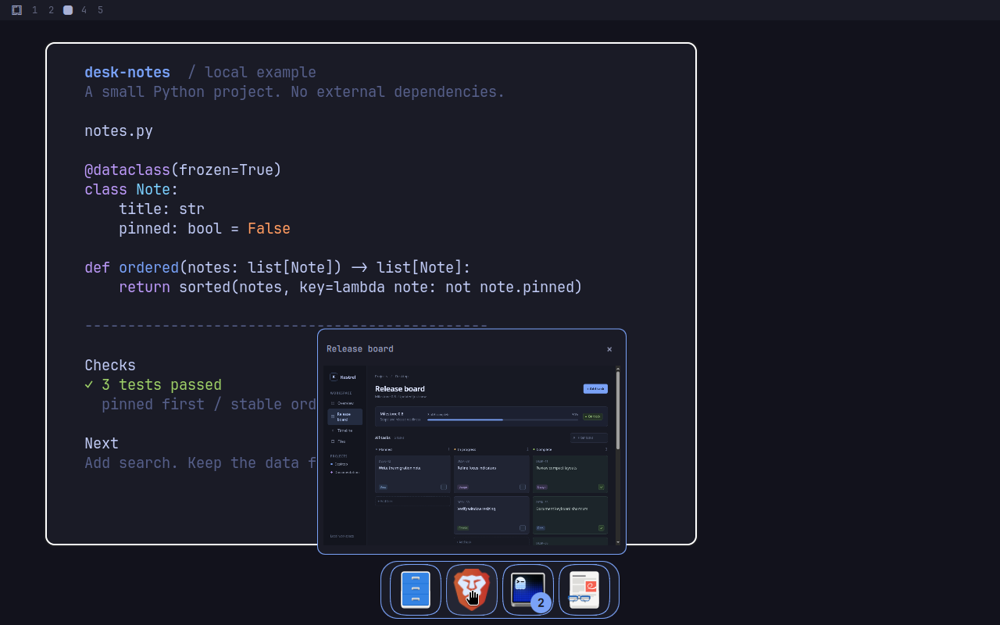
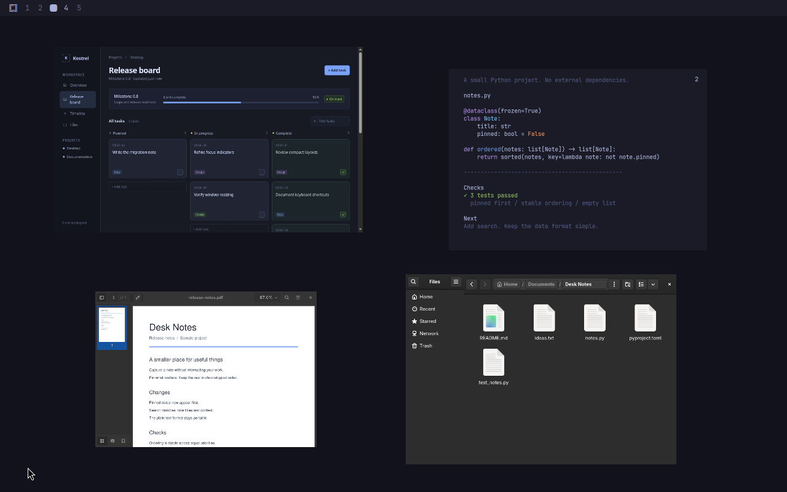
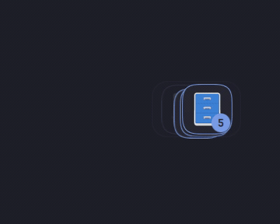
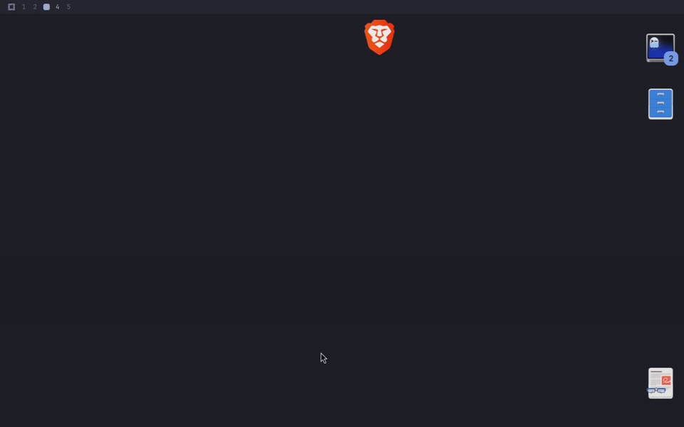
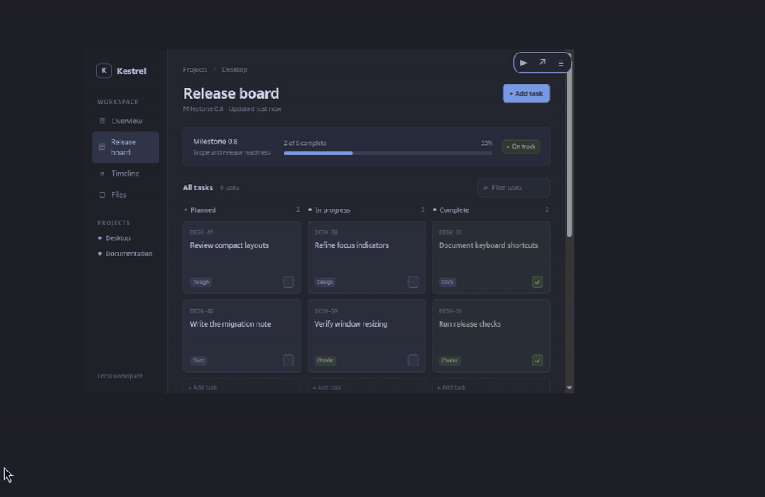

# Window Stash


Window minimization for **tiling layouts** in Omarchy/Hyprland. Stash running windows
in a private workspace and restore them to the current or original workspace.
Floating windows retain size and position; scrolling layouts retain window width.

| Mode | Behavior |
|---|---|
| Static dock | Four edges, bar clearance and overflow scrolling. Unlock to drag along the edge; lock to retain placement. |
| Floating dock | Draggable stack. One window restores directly; multiple windows unfold into a row or column. |
| Floating icons | Independent draggable icons with edge snapping or free placement. Called **Floating bubbles** in Settings. |
| Floating previews | Resizable window miniatures with snapshot or live updates. Optional mouse/keyboard interaction and fullscreen inside the preview. |

The default is a floating dock. All modes follow Omarchy's theme and support
individual windows or app groups. Visibility is global across monitors or filtered
by original workspace. Positions persist per monitor; static dock placement also
persists per edge. An empty stash occupies no screen space.

Omarchy's floating workspace mode uses its native dock. Individual floating windows
on tiled workspaces remain supported.

| Static dock with grouping and hover previews | Floating previews |
|---|---|
|  |  |

Actual application captures with offline example files. [Capture details](docs/media/README.md).

## Installation

Works on **Omarchy 4 and 4.5**. Requires Python 3, Git, Hyprland Lua IPC
(`hyprctl eval`/`repl`) with runtime `hl.bind`/`hl.on` support, and the shell modules
`qs.Commons`, `qs.Ui`, `Quickshell.Widgets`, `QtQuick.Effects` and `Quickshell.Wayland`.
Install as your desktop user:

```sh
omarchy plugin add https://github.com/artu-ole/omarchy-window-stash --enable
```

Update:

```sh
omarchy plugin update community.window-stash
```

Remove:

```sh
omarchy plugin remove community.window-stash
```

Setup and cleanup are automatic. Disabling or removing restores owned stashed windows
and releases shortcuts; updates and shell restarts retain the stash. Preferences
and positions survive removal. Occupied shortcuts remain inactive and report a
conflict in Settings without replacing personal bindings.

Older Git-managed helper installations migrate on load, backing up verified
legacy integrations before removing them. Run `omarchy restart shell` once after
updating if the old service remains loaded. Customized files and explicit personal
overrides are preserved.

## Controls

| Input | Action |
|---|---|
| Super+D | Minimize the focused window, or fold the hovered preview into an icon. |
| Super+Z | Restore newest eligible window: last in, first out. |
| Super+Alt+Z | Restore oldest eligible window: first in, first out. |
| Click icon | Restore; folded previews unfold first. App groups open a chooser; floating stacks unfold. |
| Click preview | Restore; app covers expand into individual thumbnails. Optional **First click** activation enters interaction instead. |
| Preview Interact control | Enter interaction when enabled. |
| Super+left click preview content | With interaction enabled, enter on release without restoring or clicking the app; app covers open their window choices first. |
| Interactive preview content | Application clicks, scrolling, selection and dragging; typing when click-to-focus keyboard input is enabled. |
| Ctrl+Alt+Escape / Stop | Leave preview interaction. The shortcut is configurable; plain Escape reaches the application. |
| Right-click icon/stack/view-only preview | Window/app menu, Settings, recovery and Close all. |
| Middle-click icon/view-only thumbnail | Close represented stashed window(s). Unstashed instances are unaffected. |
| Thumbnail title × | Close the represented stashed window(s); requires a title strip. |
| Drag | Move floating items or an unlocked static dock. Preview sides change proportions; corners resize proportionally. |
| Super + corner drag preview | Change width and height independently, keeping the opposite corner fixed. |
| Scroll | Scroll overflowing docks, choosers or preview groups. |
| Arrow keys / Enter | Navigate and select in choosers, unfolded docks or preview groups. |
| Escape / outside click | Dismiss menus, choosers, hover previews and expanded groups/stacks. |

Close requests wait for the client; surviving windows restore for application-owned
save prompts. Restoration preserves floating geometry, fullscreen/pinned state and
scrolling width, bounded by the destination output and layout. Tiled windows rejoin
the layout. Missing monitors use the current monitor's workspace bank and saved slot.
Windows activated through a switcher restore automatically.

Open Settings with `omarchy-shell window-stash settings`, or the recovery chooser
with `omarchy-shell window-stash all`; both work with an empty stash.

Shortcut fields support Apply, disable and reset to default; duplicate/occupied
chords are rejected. Updates preserve saved shortcuts, including disabled actions.
Reset all requires confirmation and retains stashed windows and positions.

## Settings

Stored in the `community.window-stash` entry in
`$XDG_CONFIG_HOME/omarchy/shell.json`. Use Settings or IPC; changes apply immediately:

```sh
omarchy-shell window-stash configure presentation floating
omarchy-shell window-stash configure sizePreset 150
```

### General and placement

| Key | Default | Values / meaning |
|---|---|---|
| `presentation` | `floating` | `dock`: static dock; `floating`: floating dock; `bubbles`: floating icons; `previews`: floating previews |
| `scope` | `global` | `global`: shared stash on all monitors; `workspace`: filter icons, newest/oldest restore and Close all by original workspace |
| `restoreDestination` | `current` | `current`, `original` |
| `grouping` | `window` | `window`, `app`; groups show a count badge |
| `dockSide` | `bottom` | `bottom`, `top`, `left`, `right` |
| `staticDockLock` | `locked` | `locked`, `unlocked`; static dock edge dragging |
| `floatingDirection` | `vertical` | `vertical`, `horizontal`; floating dock |
| `floatingPlacement` | `edges` | `edges`, `free`; floating icons, dock and previews |



Floating dock with horizontal direction and the Arc animation.

### Appearance

| Key | Default | Values / meaning |
|---|---|---|
| `iconShape` | `auto` | `auto`, `circle`, `square`, `rounded`, `squircle` |
| `sizePreset` | `"100"` | String percent: 50, 75, 100, 125, 150, 175, 200, 250, 300; icon/dock modes, bounded by usable screen area |
| `iconFrame` | `hidden` | `shown`, `hidden`; hiding removes background/border and enlarges artwork |
| `dockFrame` | `hidden` | `shown`, `hidden`; static and floating docks |
| `iconOpacity` | `100` | 0–100%; icons or floating previews at rest |
| `dockOpacity` | `100` | 0–100%; dock background/border at rest |
| `dockCorners` | `theme` | `theme`, `custom`; independent of icon shape |
| `dockCornerRadius` | `12` | 0–64 px in custom mode; clamped without cutting icons |

Default backgrounds are hidden; artwork remains opaque. Hover tints icons and
restores full opacity. Active interactive previews remain opaque. Zero-opacity
elements retain their input regions.

### Motion

| Key | Default | Values / meaning |
|---|---|---|
| `dragMotion` | `physics` | `physics`: flicks, coasting, collisions and trailing stack icons; `direct`: direct placement |
| `floatingAnimation` | `arc` | `arc`, `glide`, `cascade`, `spring`, `swing`, `matryoshka`, `matryoshka-hop`, `jumping` |
| `animations` | `full` | `full`: motion/feedback; `reduced`: fades/color; `off`: immediate |
| `animationSpeed` | `normal` | `slow` 0.5×, `relaxed` 0.75×, `normal` 1×, `fast` 1.5×, `ultrafast` 2.5× |

The floating dock unfolds from its front icon and folds after an 800 ms
pointer-leave grace. Outside clicks fold it immediately and reach the underlying
window. Speed controls transitions and stack following; hover delays and coasting
momentum are independent.



Floating icons with physics and edge gravity.

### Floating previews

Floating previews start borderless and untitled, with live updates on hover.
Drag to move, use a side to change proportions and reflow the hidden app, or use a
corner to scale proportionally. Hold Super while dragging a corner to reshape
both dimensions freely. The original window geometry and scrolling width
are preserved for restoration.

Position, size and custom proportions persist per monitor, separately from icons.
Right-click **Reset preview proportions** to return to the original ratio.
**Preview placement → Locked** prevents movement and resizing. App covers expand
into individual thumbnails for exact-window selection.

| Key | Default | Values / meaning |
|---|---|---|
| `floatingPreviewSizing` | `free` | `free`: resize directly; `preset`: use the scale dropdown |
| `floatingPreviewScale` | `"100"` | Same nine percentage presets; 100% is 280 logical px wide, bounded by screen area |
| `floatingPreviewUpdate` | `hover` | `still`: snapshot; `hover`: live on hover; `live`: always live |
| `floatingPreviewResizeRate` | `realtime` | `realtime`: Responsive; `balanced`: fewer drag updates; `release`: reflow the app after release |
| `floatingPreviewTitles` | `hidden` | `hidden`, `shown`; optional title strip and close button |
| `floatingPreviewFrame` | `hidden` | `hidden`, `shown`; optional background and border |
| `floatingPreviewLock` | `unlocked` | `unlocked`, `locked`; retain placement and dimensions |

Snapshot previews temporarily update live during Responsive/Balanced side or Super-corner drags,
then return to Snapshot on release. Ordinary corner resizing keeps its existing capture policy.

Minimize while hovering a preview to fold it into a floating icon. Clicking that
icon returns to the preview; restoring again returns the full window. Newest/FIFO
shortcuts follow the same stages without changing stash order. Icon and preview
positions persist separately; folded icons use the existing appearance, size and
placement settings. App covers fold as a group; individual thumbnails fold separately.

Changing proportions uses the [native preview support](#native-preview-support)
described below. Use **Stop** or **Manage** before moving an interactive
preview.

### Preview interaction

Choose **Display mode → Floating previews**, then set **Preview interaction →
Interactive previews → On**. Start with **Interact** or **Super+left click** on
preview content. Super-click activates on release without forwarding the click to
the app. App covers expand first so you can select an individual window.



App input and optional resizing; **Resize while interacting** is enabled here.

| Key | Default | Values / meaning |
|---|---|---|
| `floatingPreviewInteraction` | `off` | `off`, `on`; floating previews only |
| `floatingPreviewActivation` | `explicit` | `explicit`: Interact control/context action; `click`: first click enters interaction without forwarding it. Super+left click works with either setting |
| `floatingPreviewKeyboard` | `mouse` | `mouse`: pointer only; `click`: content click also acquires keyboard focus; hover never does |
| `floatingPreviewFullscreen` | `preview` | `preview`: fullscreen stays inside the miniature; `desktop`: restore the window for fullscreen |
| `floatingPreviewInteractionFps` | `"60"` | `"30"`, `"60"`; active preview rendering limit |
| `floatingPreviewControls` | `hover` | `hover`, `always`; controls stay visible during interaction |
| `floatingPreviewInteractionResize` | `off` | `off`, `on`; optional resize handles during interaction |
| `floatingPreviewExitShortcut` | `CTRL + ALT + Escape` | Session-only exit chord; empty disables it. Occupied desktop shortcuts are rejected. |

One preview at a time receives application clicks, scrolling and dragging.
**Application input → Mouse and keyboard** also supports typing, selection,
copy/paste and application shortcuts after a content click acquires keyboard focus.
Opening or switching browser tabs stays inside the preview.

**Fullscreen → Inside preview** is the default. A video's fullscreen button fills
the miniature; F11 or Super+F does the same while it has keyboard focus. Fullscreen
content remains expanded after Stop or an outside click; restoring reapplies the
saved window geometry and fullscreen state. **Fullscreen → On desktop** restores
the full window instead. For continuous picture-in-picture, use **Preview updates
→ Always live** and **Live preview support → Enhanced**.

**Resize while interacting** optionally keeps handles available during
interaction (Off by default). App input pauses during the drag and resumes when
the resized preview is ready. The themed outline and
**Stop / Restore / Manage** controls remain available.
**Stop**, **Ctrl+Alt+Escape** or an outside click ends interaction; moving the
pointer away keeps it active. Plain Escape reaches the application.

Modal dialogs, popups extending outside the miniature and external activation or
window-management requests restore the full window to the configured destination.
Pointer-locked apps, cross-window drag-and-drop and input-method popup positioning
require the restored window. Interaction respects `no_screen_share`; keyboard
input also respects `no_focus` window rules.

### Hover previews

The three icon/dock modes support optional snapshots or live previews on hover:

| Key | Default | Values / meaning |
|---|---|---|
| `hoverPreview` | `off` | `off`, `still`, `live` |
| `livePreviewCompatibility` | `standard` | `standard`: client-supplied frames; `enhanced`: optional native rendering support |
| `previewSize` | `medium` | `small`, `medium`, `large`: maximum widths 200/280/380 logical px, bounded by screen area |
| `previewPlacement` | `auto` | `auto`, `above`, `below`, `left`, `right`; adjusts to available space |
| `previewTitles` | `shown` | `shown`, `hidden`; title strips include the close button |
| `previewDelay` | `400` | 0–1500 ms before opening |
| `previewHideDelay` | `200` | 0–1000 ms pointer-transfer grace |

Still captures once per opening; Live refreshes supplied frames. App groups show
individual thumbnails with overflow scrolling. Hovering leaves the source window
stashed; click restores, middle-click closes and right-click opens its menu.

### Native preview support

**Standard** previews use application-supplied frames and can freeze when a hidden
app stops drawing. **Enhanced** keeps visible live previews updating, including
Ghostty/btop. For hover previews, set **Hover preview → Live** and **Live preview
support → Enhanced**; floating previews use their own update setting.

Enhanced updates, custom preview proportions and interaction use a local Hyprland
bridge, built and loaded automatically as needed. Requires x86-64, a C++26 compiler,
`pkg-config` and development headers matching the running compositor. Enabling
interaction prepares support even with Standard/snapshot previews; active input
uses live capture independently of those preferences. Setup errors appear in
Settings. Ordinary stash actions and Standard previews remain available.

Enhanced updates are limited to 15 FPS; active interaction has a separate 30/60 FPS
limit. Hidden previews release capture resources; capture pauses on screen lock
or display sleep. Application-level throttling can still limit updates.

Bridge updates offer **Reload preview support / Later** in Settings and a
notification. Reload preserves applications and the stash while ending interaction
and temporary preview fullscreen. Older experimental bridges or mismatched
compositor headers require logout/login. See [native/README.md](native/README.md)
for build details and [docs/interactive-previews.md](docs/interactive-previews.md)
for input routing and compatibility boundaries.

### Shortcuts

| Key | Default | Meaning |
|---|---|---|
| `minimizeShortcut` | `SUPER + D` | Stash focused window |
| `restoreLastShortcut` | `SUPER + Z` | Restore newest eligible window |
| `restoreOldestShortcut` | `SUPER + ALT + Z` | Restore oldest eligible window |

Empty strings disable an action. Restore actions follow visibility scope and the
configured destination. Per-field reset and Reset all use the same defaults.
The interactive exit chord above is active only during interaction and does not
register another global binding.

## API and implementation

Shell IPC exposes `settings`, `all`, `minimize`, `restoreLast`, `restoreOldest`,
`configure KEY VALUE`, `status`, `refresh` and `dismiss` through
`omarchy-shell window-stash`.

The Python controller returns JSON and exits nonzero on failure:

```sh
controller="$HOME/.config/omarchy/plugins/community.window-stash/controller/stash.py"
python3 "$controller" --help
```

Commands: `minimize [--address ADDRESS]`, `restore ID`, `restore-last`,
`restore-oldest`, `restore-all`, `close ID [ID ...]`, `close-all`, `activate ADDRESS`,
`shortcut KEY BINDING`, `shortcuts-sync`, `interaction-exit-shortcut BINDING`,
`reset-settings --confirm`, `list`, `status`.
Restore/activate accept `--to current|original`; restore/activate/close accept
`--monitor OUTPUT --workspace ID`. `restore-all` ignores visibility scope.
Internal helpers: `position MONITOR KEY X Y`,
`preview-position MONITOR KEY X Y WIDTH [--aspect RATIO]`,
`preview-aspect ID RATIO --axis width|height [--settle]`, `preview-geometry ID`,
`rebase OLD_ID NEW_ID`.

[Service.qml](Service.qml) and [ui/](ui/) provide the QML frontend.
[controller/](controller/) manages the locked ledger, runtime shortcuts and cleanup
guardian. Only owned/tagged windows on `special:window-stash` are managed.
Shell restarts retain the stash; logout or compositor restart does not restore
application sessions.

| Local data | Location |
|---|---|
| Settings | `$XDG_CONFIG_HOME/omarchy/shell.json` |
| Session ledger and locks | `$XDG_RUNTIME_DIR/omarchy-window-stash/<compositor signature>/` |
| Positions, preference checkpoint, recovery errors and migration backups | `$XDG_STATE_HOME/omarchy/window-stash/` |
| Optional bridge cache | `$XDG_CACHE_HOME/omarchy/window-stash/preview-bridge/` |

XDG config/state default to `~/.config` and `~/.local/state`. Records contain window
titles, app IDs, monitor identifiers and geometry. Runtime data stays local; no
telemetry or network requests. Icons use local themes; preview frames stay in
memory and are discarded on close. Keep runtime data out of commits.

## Development

```sh
python3 tools/check.py
```

Checks require Python, Node.js, `qs`, Qt6 `qmllint` and Omarchy's validator with `jq`;
standalone Lua enables binding and focus tests. Native suites additionally use GTK4
introspection, `wtype`, `notify-send` and `grim`. See [tests/](tests/) and
[VALIDATION.md](VALIDATION.md), including `tests/live_compatibility.py` for actual
Ghostty/btop and browser pixels. Follow [AGENTS.md](AGENTS.md): announce input
automation five seconds ahead and preserve the desktop. Legacy live suites require
an empty, isolated session.

Copyright © 2026 **artu-ole**. [AGPL-3.0-only](LICENSE).
[Third-party notices](THIRD_PARTY_NOTICES.md).

OpenAI Codex assisted extensively with implementation, tests, documentation and
debugging; the header image was generated with OpenAI image generation. The plugin
makes no AI service calls at runtime.
