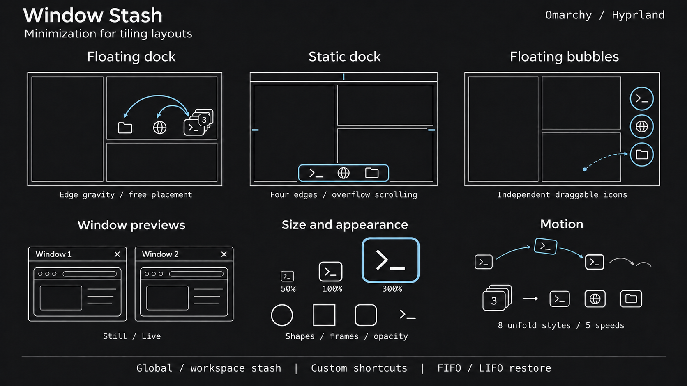

# Window Stash



Window minimization for tiling layouts in Omarchy/Hyprland. Stash live windows and
restore them to their original or current workspace. Floating windows retain size
and position; tiled windows rejoin the layout with saved width in scrolling layouts.

A QML frontend inside Omarchy's shell and a standard-library Python controller,
with optional native support for live previews of suspended applications.
Defaults: floating dock, edge
gravity, transparent dock background, frameless icons, Normal animation speed.

| Presentation | Behavior |
|---|---|
| Static dock | Any of four edges; unlock to slide along its edge, respect bar reservations, and scroll on overflow. |
| Floating icons | Individual draggable icons, initially at the middle right; edge gravity or free placement. |
| Floating dock | One draggable stack; one window restores directly, multiple windows unfold into a row or column. |

All modes use Omarchy's theme and controls, with global or per-workspace visibility
and per-window or per-app grouping. An empty stash takes no screen space or input.

## Install, update, remove

Works on Omarchy 4 and 4.5. The shell must provide `qs.Commons`, `qs.Ui`,
`Quickshell.Widgets`, `QtQuick.Effects` and `Quickshell.Wayland`.
Have `omarchy`, `omarchy-shell`, `hyprctl`, `~/.config/hypr/bindings.lua` and
`~/.config/omarchy/shell.json` available. Install as your normal desktop user:

```sh
omarchy plugin add https://github.com/artu-ole/omarchy-window-stash
python3 ~/.config/omarchy/plugins/community.window-stash/tools/install.py &&
    omarchy plugin enable community.window-stash &&
    omarchy restart shell
```

When `add` asks whether to enable the plugin, choose **No**; enable it after setup.
`omarchy plugin add` manages the Git checkout. The bundled setup creates
`~/.local/bin/window-stash` and adds a marked shortcut loader
to `bindings.lua`. The helper previews changes and asks for confirmation (`--yes`
for automation). It checks shortcut conflicts, backs up config,
reloads Hyprland while preserving runtime monitor geometry, and rescans plugins.
It uses no root privileges or packaged-file edits. `community.window-switcher`, if
present, is patched for restoration; incompatible anchors abort installation.
Tested with switcher 1.0.0.

Window Stash uses its own hidden workspace. Updating migrates only verified
plugin-owned legacy entries; other minimized windows stay untouched.

Update the CLI-managed checkout and rerun setup; existing preferences persist:

```sh
omarchy plugin update community.window-stash
python3 ~/.config/omarchy/plugins/community.window-stash/tools/install.py
omarchy restart shell
```

Before removal, run cleanup to restore parked windows, disable the plugin and
remove its wrapper, managed binding block and known switcher edits. Then let the
CLI remove the checkout:

```sh
python3 ~/.config/omarchy/plugins/community.window-stash/tools/install.py --prepare-remove &&
    omarchy plugin remove community.window-stash
```

**Run cleanup first:** `omarchy plugin remove` does not run cleanup hooks.
Preferences and saved positions remain. Backups are under
`$XDG_STATE_HOME/omarchy/window-stash/backups` (default
`~/.local/state/omarchy/window-stash/backups`).

For an older helper-only installation, run `python3 tools/install.py --prepare-remove`
from an up-to-date source checkout, then `omarchy plugin remove community.window-stash`
and follow the install commands above. This converts it
to a CLI-managed checkout while keeping preferences and positions.

## Use

| Action | Input |
|---|---|
| Stash focused window | Super+A |
| Restore newest eligible window | Super+Z; last in, first out |
| Restore oldest eligible window | Assign Restore oldest in Settings; first in, first out |
| Restore / choose an app-group window | Click an icon; groups open a searchable chooser |
| Window actions and global actions | Right-click an icon or stack; pointer-positioned context menu |
| Close represented stashed window(s) | Middle-click an icon; collapsed stacks target the front icon |
| Move floating icons / dock | Drag; positions persist per monitor |
| Move static dock | Unlock in Placement, then drag an icon or the background along its edge |
| Navigate chooser / unfolded dock | Arrow keys and Enter; navigation follows dock direction |
| Fold floating dock | Escape, outside click or workspace change |
| Preview a window | Hover an icon, stack or chooser row; enable previews in Settings |

Context menus separate window/app actions from Settings, recovery and scope-aware
Close all; outside clicks dismiss and reach the underlying window. Open Settings
or recovery with an empty stash:

```sh
omarchy-shell window-stash settings
omarchy-shell window-stash all
```

Edit shortcuts in Settings: Apply saves and activates, × disables, ↺ restores
its default. Restore oldest starts unbound; duplicate/occupied chords are rejected.
Bindings survive shell/compositor reloads; installation preserves personal bindings
and migrates the managed block's explicit overrides.

Settings are grouped by purpose and scroll within the monitor's usable area.
Narrow layouts stack controls; keyboard focus scrolls fields into view.
Reset all settings requires confirmation and restores every preference and default
shortcut atomically. Conflicts leave
settings and bindings intact; parked windows and positions are retained.
CLI equivalent: `window-stash reset-settings --confirm`.

To move a static dock, unlock **Placement → Static dock position**, then drag
any icon or its background along the selected edge. Lock it again to keep that
placement, or leave it unlocked. Each completed drag is saved separately for
each monitor and edge; positions survive locking and shell restarts.

## Configuration reference

Settings live in the `community.window-stash` entry in `~/.config/omarchy/shell.json`.
Use Settings or plugin-scoped IPC; changes apply without a shell restart:

```sh
omarchy-shell window-stash configure presentation dock
omarchy-shell window-stash configure sizePreset 150
omarchy-shell window-stash configure floatingAnimation jumping
omarchy-shell window-stash configure hoverPreview live
```

| Key | Default | Values / meaning |
|---|---|---|
| `presentation` | `floating` | `dock`, `bubbles`, `floating` |
| `scope` | `global` | `global`: repeat stash on every monitor; `workspace`: filter by each monitor's active workspace |
| `restoreDestination` | `current` | `current`, `original` |
| `grouping` | `window` | `window`, `app`; app groups have a count badge and searchable chooser |
| `iconShape` | `auto` | `auto`, `circle`, `square`, `rounded`, `squircle`; retained while frameless |
| `sizePreset` | `100` | `50`, `75`, `100`, `125`, `150`, `175`, `200`, `250`, `300` percent; all presentations |
| `dockSide` | `bottom` | `bottom`, `top`, `left`, `right`; static dock |
| `staticDockLock` | `locked` | `locked`, `unlocked`; allow dragging the static dock along its edge |
| `floatingDirection` | `vertical` | `vertical`, `horizontal`; floating dock |
| `floatingAnimation` | `arc` | `arc`, `glide`, `cascade`, `spring`, `swing`, `matryoshka`, `matryoshka-hop`, `jumping` |
| `floatingPlacement` | `edges` | `edges`, `free`; both floating presentations |
| `dragMotion` | `physics` | `physics`: momentum/collisions; `direct`: direct placement and edge glide |
| `iconFrame` | `hidden` | `shown`, `hidden`; hidden removes background/border and enlarges artwork |
| `dockFrame` | `hidden` | `shown`, `hidden`; static and floating docks |
| `dockOpacity` | `100` | Integer 0–100%; dock background and border at rest |
| `iconOpacity` | `100` | Integer 0–100%; artwork, frames and badges at rest |
| `dockCorners` | `theme` | `theme`, `custom`; independent of icon shape |
| `dockCornerRadius` | `12` | Integer 0–64 px in custom mode; clamped to panel dimensions |
| `animations` | `full` | `full`: spatial motion and feedback; `reduced`: fades/color without movement or scaling; `off`: immediate |
| `animationSpeed` | `normal` | `slow` (0.5×), `relaxed` (0.75×), `normal` (1×), `fast` (1.5×), `ultrafast` (2.5×) |
| `hoverPreview` | `off` | `off`, `still`, `live` |
| `livePreviewCompatibility` | `standard` | `standard`: capture supplied frames; `enhanced`: keep previewed suspended apps drawing with the optional native bridge |
| `previewSize` | `medium` | `small`, `medium`, `large`; maximum image widths 200/280/380 logical px, reduced to fit |
| `previewPlacement` | `auto` | `auto`, `above`, `below`, `left`, `right`; flips/shrinks when space is limited |
| `previewTitles` | `shown` | `shown`, `hidden`; title strips include a per-window × close button |
| `previewDelay` | `400` | Integer 0–1500 ms before opening |
| `previewHideDelay` | `200` | Integer 0–1000 ms grace between source and preview |
| `minimizeShortcut` | `SUPER + A` | Minimize focused window; empty disables |
| `restoreLastShortcut` | `SUPER + Z` | Restore newest eligible window; empty disables |
| `restoreOldestShortcut` | empty | Restore oldest eligible window; empty disables |

At 100%, static icons are 44 logical px and floating icons 48 px. Larger presets
cap to the usable output area. Frames can be hidden independently; large corner
radii retain icon clearance. Hover restores full opacity; pressed and selected
icons stay opaque. At 0% opacity, elements retain their usual input regions.

## Motion and previews

| Unfold style | Motion |
|---|---|
| Arc | Curved travel with a small overshoot. |
| Glide | Synchronized straight slide. |
| Cascade | Staggered icons; folding starts at the far end. |
| Spring | Weighted overshoot. |
| Swing | Wider arc with a small tilt. |
| Matryoshka | Remaining stack moves together, leaving one icon at each stop. |
| Matryoshka hops | The same deposits through successive arches. |
| Jumping | Individual jumps from the stack with squash/stretch and damped landing rebounds. |

The original front stays fixed; other icons expand toward available space.
Horizontal curves arch upward, flattening near the top edge; folding returns icons
to the stack. The background grows along the row/column with fixed thickness.
Matryoshka variants use a 1.5× base rate, multiplied by the speed preset.

An unfolded dock has an 800 ms pointer-leave grace after animation completes;
returning cancels it. Outside clicks fold immediately and reach the window below.
Scroll or drag for overflow. Speed scales transitions/staggering; hover delays,
capture timeouts and physical momentum use real time. Full/Reduced/Off apply throughout.

Physics dragging supports flicks, damped coasting and gentle collisions. Edge
gravity settles at a screen edge; free mode coasts to rest. Back icons trail the
dragged stack on damped springs, affected by animation speed, then restack.
Grabbing, menus or unfolding stop momentum; Direct and Reduced/Off keep a rigid
stack. Motion remains in the usable work area; only resting positions persist.

Still previews capture once when a thumbnail becomes visible; Live refreshes
visible thumbnails when the application supplies new frames. Standard mode can
freeze when an application stops drawing on hidden workspaces.

For suspended applications such as Ghostty, select **Live** and **Enhanced** in
Settings → Previews. This builds and loads a small local Hyprland bridge on
first use. It requires an x86-64 system, a C++26 compiler, `pkg-config` and
development headers matching the running Hyprland build. Missing or incompatible
build support leaves standard previews available and reports the error in Settings.
No global rendering settings or application profiles are changed.

Enhanced mode resumes only verified stash windows with visible live thumbnails,
at up to 15 FPS. Closing a preview, switching modes, or unloading the bridge
releases its rendering lease; expired helpers lose their lease within 2.5 seconds.
An application's own background-content throttling can still limit updates.
See [native/README.md](native/README.md) for the bridge API and build details.

App groups display windows side by side and scroll when
needed. Click a thumbnail to restore that window, right-click for its menu,
middle-click or use the title's × to close it. Hover never focuses, moves or
restores windows. Dragging, source motion, menus, settings and workspace changes
dismiss previews; hidden/offscreen captures are released.

## Restoration and controller API

- Floating windows restore logical size and monitor-relative position, bounded
  by the destination work area and application limits.
- Tiled windows rejoin the layout. Scrolling layouts append a column in their
  configured direction and recover saved width, subject to layout/application limits.
  Dwindle uses normal insertion.
- Maximized, fullscreen and pinned state is restored after geometry. A stashed
  Hyprland group member restores as a separate window.
- Empty original workspaces can be recreated. For a missing monitor, its local
  workspace slot maps to the invoking monitor's bank, honoring `hypr/monitor-workspaces.lua`.
  Workspace-ID changes update origins; arbitrary external merges cannot be reversed.
- Closed windows leave the stash. Shell restarts retain records; logout or a
  compositor restart does not restore application sessions. Other tools' scratchpads
  and minimized windows are outside plugin ownership.

The controller works without QML. Commands return JSON (`ok` and result/error);
failures exit nonzero:

```sh
window-stash minimize                         # optional --address ADDRESS
window-stash restore-last                     # newest; optional --to current|original
window-stash restore-oldest                   # oldest; same scope/destination options
window-stash restore ID --to original         # ID or live address
window-stash restore-all --to current         # recovery; ignores visibility scope
window-stash close ID [ID ...]                # owned stashed windows only
window-stash close-all                        # follows visibility scope
window-stash shortcut restoreOldestShortcut 'SUPER + ALT + Z'
window-stash shortcut restoreOldestShortcut '' # disable
window-stash shortcuts-sync
window-stash reset-settings --confirm
window-stash list                             # reconciled windows/settings/positions
window-stash status                           # alias of list
```

Restore/close accept `--monitor OUTPUT --workspace ID` to preserve context.
Close requests confirm disappearance with a shared 750 ms batch grace; survivors
restore for save prompts. Failures retain records; unstashed windows are untouched.
`activate ADDRESS` restores an owned window or focuses an unmanaged one. Internal
helpers: `position MONITOR KEY X Y`, `rebase OLD_ID NEW_ID`. Frontend IPC exposes
`status`, `refresh` and `dismiss` via `omarchy-shell window-stash`.

## Implementation and local data

[Service.qml](Service.qml) serializes requests and watches compositor/config state;
[ui/](ui/) owns surfaces, keyed actors, input regions and frame-driven physics.
[controller/stash.py](controller/stash.py) parks windows on `special:window-stash` with
ownership tags and address-reuse guards. Its locked, atomic ledger retains interrupted
restores for retry. [controller/shortcuts.py](controller/shortcuts.py) owns runtime bindings.

| Data | Location |
|---|---|
| Session ledger | `$XDG_RUNTIME_DIR/omarchy-window-stash/<sanitized compositor signature>/state.json` |
| Icon and dock positions | `$XDG_STATE_HOME/omarchy/window-stash/bubbles.json` |
| Optional bridge build cache | `$XDG_CACHE_HOME/omarchy/window-stash/preview-bridge/<Hyprland commit>/` |
| Settings / empty shortcut lock | `$XDG_CONFIG_HOME/omarchy/shell.json` / `.window-stash-shortcuts.lock` |

XDG config/state default to `~/.config` and `~/.local/state`. Records contain titles,
app IDs, monitor identifiers and geometry; persistent positions can identify monitors.
These stay local; no telemetry or network requests. Icons come from local themes.
Preview frames stay in memory and are discarded on close; no thumbnail files are
saved. Background apps may stop drawing, leaving their last frame; capture failure
falls back to an icon and respects compositor restrictions. Keep runtime data out of commits.

## Development and attribution

```sh
python3 tools/check.py # Python/Node checks, offscreen Qt, manifest, qmllint
```

See [tests/](tests/) and [VALIDATION.md](VALIDATION.md) for native suites and coverage.
Checks need Node.js, `qs`, Qt6 `qmllint`, and Omarchy's validator with `jq`;
standalone `lua` enables handle tests. Native suites need an unlocked installed
session, GTK4 introspection, `wtype`, `notify-send` and `grim`.

NativeSession-based suites preserve windows, stash and preferences. Legacy suites,
including `tests/live.py`, need an empty, isolated test desktop; read their setup
requirements first. Input automation announces itself **five seconds before starting**;
follow [AGENTS.md](AGENTS.md).
Small-display settings regression: `python3 tests/settings_fit.py`.
Enhanced pixel checks: `python3 tests/live_compatibility.py` (Ghostty/btop, Chromium
and Brave with disposable profiles). Lease lifecycle checks:
`python3 tests/preview_bridge_native.py`.

Copyright © 2026 **artu-ole** · [AGPL-3.0-only](LICENSE) ·
[Third-party notices](THIRD_PARTY_NOTICES.md).

**AI assistance.** OpenAI Codex was used extensively for implementation, tests,
documentation and debugging. The header illustration was generated with OpenAI
image generation. The plugin makes no AI service
calls at runtime.
